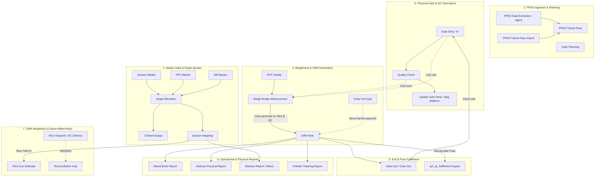

# 00: Executive Summary & System Discovery Report

## 1. Audit Context and Scope

This document presents the technical and business logic audit of the government paddy procurement application **`ivri_od`** (version 0.0.1, Git branch `main`, commit `eb897fe`) hosted within the Frappe v16 environment at `/home/hp/frappe-bench-v16`, targeting the site **`shyamji`**.

This audit was conducted strictly as a **read-only investigation**. No application code, DocType schemas, fixtures, reports, JavaScript, Python controllers, configuration files, hooks, permissions, or database records were created, mutated, submitted, cancelled, amended, or deleted.

### Environment & App Baseline
- **Bench Directory**: `/home/hp/frappe-bench-v16`
- **Application Repository**: `/home/hp/frappe-bench-v16/apps/ivri_od`
- **Current Git Branch**: `main` (commit `eb897fe`)
- **Working Tree**: Clean (no uncommitted or staged changes)
- **Bench Apps Manifest (`apps.txt`)**: `frappe`, `ivri_od`, `erpnext`, `ivri_app`, `ivri_rice_ag`
- **Site-Specific Installed Apps on `shyamji`**:
  - `frappe`: 16.30.0 (`version-16`)
  - `erpnext`: 16.31.1 (`version-16`)
  - `ivri_od`: 0.0.1 (`main`)
  *(Note: `ivri_app` and `ivri_rice_ag` are bench sibling directories but are not installed on site `shyamji`)*.

---

## 2. System Architecture Overview

`ivri_od` is a specialized Frappe application engineered to automate and manage government paddy procurement for rice mills operating under the **Odisha State Civil Supplies Corporation (OSCSC)** paddy procurement system (utilizing data from the state government **PPAS - Paddy Procurement Automation System** portal).

The application spans seven operational domains:



---

## 3. Major Verified Findings & Architectural Discoveries

### A. Non-Submittable DocTypes vs. Status Code Contradiction
- **Metadata State**: None of the DocTypes in `ivri_od` have `"is_submittable": 1` defined in their checked-in JSON schemas. Every transaction (`Gate Entry`, `Quality Check`, `RST Details`, `Weigh Bridge Measurement`, `GRN Note`, `Entry`) is a standard, non-submittable document whose default lifecycle remains at `docstatus = 0` (Draft).
- **Controller Contradiction**: In `grn_tp_fulfillment.py`, the standalone helper function `calculate_tp_status_for_pass()` strictly filters:
  ```python
  filters={"pass_unique_key": key, "is_local_procurement": 0, "docstatus": 1}
  ```
  Consequently, in a standard runtime environment without an external Frappe Workflow or custom script mutating `docstatus`, `calculate_tp_status_for_pass()` will find zero qualifying GRNs and permanently report `"Pending"`.
- **System Counter-Rule**: In contrast, the internal updater `_refresh_tp_fulfillment_for_pass()`, the reporting engine (`mandi_book.py`, `abstract_physical.py`), and `procurement_sync.py` all query with:
  ```python
  filters={"docstatus": ["<", 2]}
  ```
  This allows draft documents (`docstatus = 0`) to contribute to operational rollups. Tests in `test_tp_fulfillment.py` manually manipulate `docstatus = 1` via raw database writes (`frappe.db.set_value`), masking this schema-code discrepancy.

### B. Two Weighment Entry Paths Converging on One WBM
1. **RST-Driven Path**: The weighbridge operator enters an `RST Details` document (representing a computer RST weighment slip). Upon saving, `RST Details` automatically creates or updates a linked `Weigh Bridge Measurement` document.
2. **Direct WBM Path**: The operator creates a `Weigh Bridge Measurement` directly, linking the `Pass Unique Key` and the effective truck number.
3. In both cases, once `tare_weight > 0` and `Quality Test in ('Accepted', 'Partially Accepted')`, the system **automatically instantiates and saves a `GRN Note`** via `_ensure_grn_note_for_weigh_bridge()`.

### C. Weight and Deduction Calculations
- **Gross Weight of Paddy**: `gross_weight = max(load_weight - tare_weight, 0)` when tare is present; if tare is 0 or missing, `gross_weight = load_weight`.
- **Gunny Weight Deduction**:
  - If `gunny_type == 'Gunny Gross'`, `gunny_weight = 0`.
  - If `gunny_type == 'Gunny Cut'`, `gunny_weight` is derived from child table `bag_weight_details` (calculated from jute bag weight and plastic bag weight in kg divided by 100 kg/QTL), with manual override taking precedence if entered > 0.
- **Net Weight Formula**:
  $$\text{net\_weight} = \max(\text{gross\_weight} - \text{gunny\_weight} - \text{deduction}, 0)$$
  All quantities are rounded and stored to 3 decimal places (Quintals - QTL).

### D. Chhatni (Shortfall/Moisture Deduction) Mechanics
- **Semantic Definition**: `Chhatni` represents the allowed or demanded percentage allowance for excess paddy weight delivered by PPCs/agents to compensate for moisture, refraction, dust, or milling loss.
- **Rate Equivalence**: As defined in `chhatni_assign.py`:
  $$\text{chutney\_percentage} = \text{chutney\_quantity\_kg\_per\_quintal}$$
  Because $1\text{ quintal} = 100\text{ kg}$, $1\text{ kg per quintal} = 1.0\%$.
- **Hard-coded Tolerance**: A fixed tolerance of **$\pm 0.30$ percentage points** (`CHHATNI_TOLERANCE_PCT = 0.30`) is hard-coded in `grn_tp_fulfillment.py`.
- **Status Evaluation**:
  - If cumulative received quantity $< \text{TP quantity}$, Chhatni evaluation is blocked: `"Chhatni cannot be calculated because the transit pass (TP) quantity is not fully received yet."`
  - Once cumulative received $\ge \text{TP quantity}$:
    $$\text{actual\_pct} = \frac{\text{cumulative\_received} - \text{tp\_qty}}{\text{tp\_qty}} \times 100$$
    - If $\text{actual\_pct} > \text{assigned\_pct} + 0.30$: **"Extra Chhatni Received"**
    - If $\text{assigned\_pct} - 0.30 \le \text{actual\_pct} \le \text{assigned\_pct} + 0.30$: **"Chhatni Received"**
    - If $\text{actual\_pct} < \text{assigned\_pct} - 0.30$: **"Chhatni Not Received"**
- **Locking Behavior**: In `GRN Note`, `chhatni` is fetched from `Season Mapping` only when the document is new (`self.is_new()`). Subsequent saves or updates to `Target Allocation` do not alter the locked historical rate on existing GRNs.

### E. Explicit Disabling of Local Procurement
Although schemas and legacy controllers contain fields and documents for private/local paddy procurement (`is_local_procurement`, `Local Paddy Purchase Order`, `is_farmer_or_agent`), the controllers actively throw validation exceptions if any new local procurement transaction is attempted:
```python
frappe.throw(_("Local Paddy Purchase is disabled. Only Government Paddy Purchase is currently supported."))
```
The codebase has been refactored to support exclusively Government Paddy Purchase under the OSCSC schema.

### F. Status of the CMR (Custom Milled Rice) Module
- **Current State**: `ivri_od` contains **NO** dedicated CMR DocTypes, no milling batch execution, no rice godown inventory tracking, no OSCSC/FCI delivery challan transactions, and no ledger-based reconciliation between paddy consumed and rice delivered.
- **Available Footprint**:
  1. `GRN Note.cmr_season`: stores the government season identifier.
  2. `Season Mapping`: stores `rice_yield` (e.g. 67%), calculates `rice_due_till_date = (paddy_procured_till_date * rice_yield) / 100`, and exposes an unused field `rice_dispatched`.
- **Conclusion**: The CMR module is currently **an incomplete planning stub**, requiring formal specification and implementation before it can support operational rice milling and delivery reconciliation.

---

## 4. Deliverable Directory Map

All deliverables are generated and organized in the dedicated audit package directory:
`docs/system_workflow_audit/` (accessible directly within `apps/ivri_od/docs/system_workflow_audit/` and mirrored via symlink from the bench root `docs/system_workflow_audit/`):

| File | Title & Core Subject |
|---|---|
| [`00_EXECUTIVE_SUMMARY.md`](file:///home/hp/frappe-bench-v16/apps/ivri_od/docs/system_workflow_audit/00_EXECUTIVE_SUMMARY.md) | High-level architectural map, module inventory, critical findings, and risks |
| [`01_DOCTYPE_INVENTORY.md`](file:///home/hp/frappe-bench-v16/apps/ivri_od/docs/system_workflow_audit/01_DOCTYPE_INVENTORY.md) | Comprehensive inventory of all 30 custom DocTypes, child tables, and field definitions |
| [`02_BUSINESS_WORKFLOWS.md`](file:///home/hp/frappe-bench-v16/apps/ivri_od/docs/system_workflow_audit/02_BUSINESS_WORKFLOWS.md) | End-to-end operational workflows, actors, triggers, preconditions, and failure paths |
| [`03_FORMULAS_AND_TOLERANCE.md`](file:///home/hp/frappe-bench-v16/apps/ivri_od/docs/system_workflow_audit/03_FORMULAS_AND_TOLERANCE.md) | Reverse-engineered mathematical formulas, tolerance limits, units, and worked examples |
| [`04_RELATIONSHIPS_AND_DATA_LINEAGE.md`](file:///home/hp/frappe-bench-v16/apps/ivri_od/docs/system_workflow_audit/04_RELATIONSHIPS_AND_DATA_LINEAGE.md) | Explicit DocType link dependencies, child tables, and report data lineage backward tracing |
| [`05_DYNAMIC_SCENARIOS_AND_GAPS.md`](file:///home/hp/frappe-bench-v16/apps/ivri_od/docs/system_workflow_audit/05_DYNAMIC_SCENARIOS_AND_GAPS.md) | Scenario matrix of edge cases, multi-GRN fulfillment, defects, and test coverage |
| [`06_CMR_READINESS_AND_ROADMAP.md`](file:///home/hp/frappe-bench-v16/apps/ivri_od/docs/system_workflow_audit/06_CMR_READINESS_AND_ROADMAP.md) | Capability gap analysis for Custom Milled Rice and phased technical implementation roadmap |
| [`07_WORKFLOW_DIAGRAMS.md`](file:///home/hp/frappe-bench-v16/apps/ivri_od/docs/system_workflow_audit/07_WORKFLOW_DIAGRAMS.md) | Complete Mermaid diagrams (Context, Workflows, Weighment, Formulas, Reports, CMR) |
| [`08_EVIDENCE_AND_OPEN_QUESTIONS.md`](file:///home/hp/frappe-bench-v16/apps/ivri_od/docs/system_workflow_audit/08_EVIDENCE_AND_OPEN_QUESTIONS.md) | Code citations, line numbers, test outcomes, contradictions, and open business questions |
| [`09_AUDIT_MANIFEST.md`](file:///home/hp/frappe-bench-v16/apps/ivri_od/docs/system_workflow_audit/09_AUDIT_MANIFEST.md) | Timestamp, environment boundaries, exclusions, and verification declarations |
