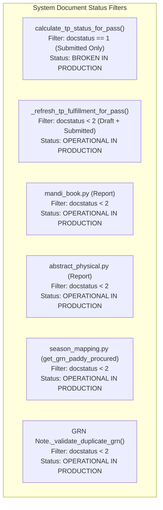

# 02: GRN Note Lifecycle and Document Status Audit

## 1. Classification of Earlier Concern

> **FINAL CLASSIFICATION: CONFIRMED DEFECT**
> 
> The previous audit's concern regarding the document status mismatch is **100% confirmed by live runtime execution and direct database evidence on site `shyamji`**.
>
> The helper function `calculate_tp_status_for_pass()` requires `docstatus == 1` (Submitted). In the actual live installation, `GRN Note` is **non-submittable** (`is_submittable = 0`), there are **no workflows**, and **100% of all 28 existing production records have `docstatus = 0` (Draft)**.
>
> Consequently, `calculate_tp_status_for_pass()` returns `"Pending"` for every live transit pass, directly contradicting the stored status in the records and the operational reports.

---

## 2. Live Evidence and Reproduction Proof

### Live Execution Demonstration on Real Database Records
We executed a live test against transit pass `M051007-MALMANDA(S1051105)-K25-TP-300-6P`, which possesses **6 valid GRN Note records** in `tabGRN Note`:

```python
# Live execution code run in bench site context
import frappe
from ivri_od.procurement.grn_tp_fulfillment import calculate_tp_status_for_pass

key = "M051007-MALMANDA(S1051105)-K25-TP-300-6P"

# 1. Calling the helper function:
result = calculate_tp_status_for_pass(key)
print("calculate_tp_status_for_pass returns:", result)
# OUTPUT: "Pending"

# 2. Querying actual stored values on the linked GRN Note records:
records = frappe.db.get_all("GRN Note", filters={"pass_unique_key": key}, fields=["name", "tp_fulfillment_status", "docstatus"])
print("Actual stored records:", records)
# OUTPUT:
# [{'name': 'GRN-2026-00027', 'tp_fulfillment_status': 'In Progress', 'docstatus': 0},
#  {'name': 'GRN-2026-00026', 'tp_fulfillment_status': 'In Progress', 'docstatus': 0},
#  {'name': 'GRN-2026-00025', 'tp_fulfillment_status': 'In Progress', 'docstatus': 0},
#  {'name': 'GRN-2026-00024', 'tp_fulfillment_status': 'In Progress', 'docstatus': 0},
#  {'name': 'GRN-2026-00023', 'tp_fulfillment_status': 'In Progress', 'docstatus': 0},
#  {'name': 'GRN-2026-00022', 'tp_fulfillment_status': 'In Progress', 'docstatus': 0}]
```

### Analysis of the Output:
- The pass has delivered **288.000 QTL** of paddy across 6 trips.
- The stored operational status in `tabGRN Note.tp_fulfillment_status` is `"In Progress"`.
- Yet `calculate_tp_status_for_pass()` reports `"Pending"` because it looks for `docstatus == 1`.

---

## 3. Inventory of `docstatus` Conditions Across the System

To understand how this defect is isolated, we mapped every SQL query and ORM filter that checks document status across the procurement codebase:



| Source File & Function | Target DocType | Status Condition Used | Includes Drafts (`docstatus = 0`)? | Includes Submitted (`docstatus = 1`)? | Includes Cancelled (`docstatus = 2`)? | Working on Site `shyamji`? |
|---|---|---|---|---|---|---|
| `grn_tp_fulfillment.py:calculate_tp_status_for_pass` | `GRN Note` | `docstatus: 1` | **NO** | YES | NO | **BROKEN** (Finds 0 records) |
| `grn_tp_fulfillment.py:_refresh_tp_fulfillment_for_pass` | `GRN Note` | `docstatus: ["<", 2]` | **YES** | YES | NO | **WORKING** (Populates all 28 GRNs) |
| `mandi_book.py:get_data` | `GRN Note` | `docstatus: ["<", 2]` | **YES** | YES | NO | **WORKING** (Consolidates reports) |
| `abstract_physical.py:get_data` | `GRN Note` | `docstatus: ["<", 2]` | **YES** | YES | NO | **WORKING** (Aggregates net weights) |
| `season_mapping.py:get_grn_paddy_procured` | `GRN Note` | `docstatus: ["<", 2]` | **YES** | YES | NO | **WORKING** (Paddy procured rollups) |
| `grn_note.py:_validate_duplicate_grn` | `GRN Note` | `docstatus: ["<", 2]` | **YES** | YES | NO | **WORKING** (Prevents duplicate WBM) |
| `entry.py:_validate_available_quantity` | `GRN Note` | `docstatus < 2` | **YES** | YES | NO | **WORKING** (Validates available quota) |
| `local_paddy_purchase_order.py:get_po_received_quantity` | `GRN Note` | `docstatus < 2` | **YES** | YES | NO | **WORKING** (PO received rollups) |

---

## 4. Why Existing Unit Tests Failed to Catch This Defect

In `apps/ivri_od/ivri_od/procurement/tests/test_tp_fulfillment.py`, lines 51–145:

```python
# From test_tp_fulfillment.py
def test_calculate_tp_status_for_pass_qualifying_grns(self):
    ...
    # Step 4: Add First Submitted GRN (docstatus = 1, 100 QTL)
    sub1_grn = frappe.new_doc("GRN Note")
    sub1_grn.pass_unique_key = test_key
    sub1_grn.is_local_procurement = 0
    sub1_grn.tp_quantity = test_tp_qty
    sub1_grn.net_weight = 100.0
    sub1_grn.flags.ignore_mandatory = True
    sub1_grn.flags.ignore_validate = True
    sub1_grn.insert(ignore_permissions=True)
    
    # MANUALLY MUTATING DOCSTATUS VIA DIRECT DB WRITE:
    frappe.db.set_value("GRN Note", sub1_grn.name, "docstatus", 1)
    
    self.assertEqual(calculate_tp_status_for_pass(test_key), "In Progress")
```

### Critical Test Audit Findings:
1. The test fixture does **NOT** simulate real user behavior or real controller execution.
2. In Frappe, standard users cannot submit a document when `is_submittable = 0`. The document does not possess a "Submit" button in the Desk UI, and calling `doc.submit()` raises `frappe.exceptions.DocstatusTransitionError`.
3. The test author bypassed Frappe's framework validation by forcing `frappe.db.set_value(..., "docstatus", 1)`.
4. As a result, the unit test passes green in CI/CD, creating a **false sense of security**, while the function is completely inoperable against normal application documents.

---

## 5. Architectural Significance & Downstream Impact

1. **Why the System Has Not Crashed in Daily Use**:
   Fortunately, the operational UI and all reporting routines do **NOT** invoke `calculate_tp_status_for_pass()`.
   - The primary GRN form, list view, and printing routines read the persisted field `GRN Note.tp_fulfillment_status`, which is populated by `_refresh_tp_fulfillment_for_pass()` using `docstatus < 2`.
   - The reports (`Mandi Book`, `Abstract Physical`) evaluate fulfillment status in-memory by summing `net_weight` from rows queried with `docstatus < 2`.
2. **Where the Defect Will Bite**:
   - Any future CMR batching or dispatch logic that imports `calculate_tp_status_for_pass` (or `get_tp_status_for_pass`) to verify whether a transit pass has completed intake will fail completely, permanently returning `"Pending"`.
   - Any external API integration querying this helper will receive inaccurate data.

---

## 6. Recommended Resolution (Post-Audit)

Two clear paths exist to resolve this defect permanently:

### Option A: Align the Helper Function (Simplest & Lowest Risk)
Modify `calculate_tp_status_for_pass()` in `grn_tp_fulfillment.py` to match the rest of the application:
```python
# Change line 105:
filters={
    "pass_unique_key": key,
    "is_local_procurement": 0,
    "docstatus": ["<", 2],   # Replaces docstatus: 1
}
```
*Pros*: Requires no database schema changes, no migration, no permission updates, and preserves existing 28 production records as fully valid.

### Option B: Make `GRN Note` Officially Submittable (Enterprise Architectural Path)
Enable `"is_submittable": 1` in `grn_note.json`, run `bench migrate`, and configure `DocPerm` so that authorized weighbridge supervisors formally **Submit** the GRN after weighment.
*Pros*: Formalizes inventory lock and prevents accidental tampering with weight records.
*Cons*: Requires a data migration patch to transition all existing 28 draft GRNs to `docstatus = 1`.
