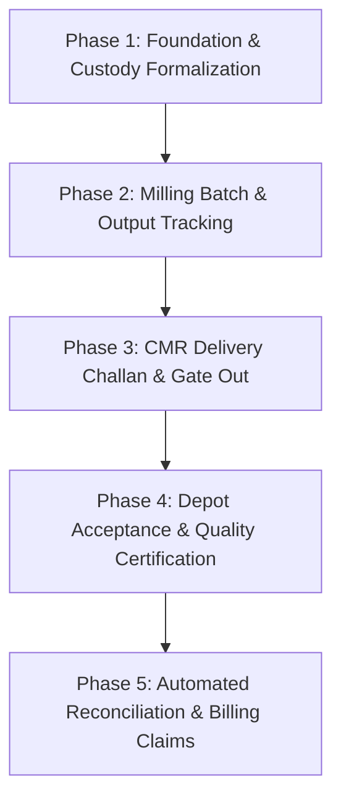

# 06: CMR Module Readiness Assessment & Phased Completion Roadmap

## 1. Domain Definition: What is CMR in this Application?

In the Indian government paddy procurement framework (specifically in Odisha under the **Odisha State Civil Supplies Corporation - OSCSC** and **Food Corporation of India - FCI** regulations):

- **CMR stands for Custom Milled Rice**.
- **Statutory Mandate**: Government paddy procured at Primary Procurement Centers (PPCs) and delivered to private rice mills remains state property held in custody by the miller.
- **Conversion / Outturn Ratio**: In return for the raw paddy lifted, the miller is legally obligated to deliver a statutory percentage of finished milled rice back to government godowns/depots (typically **67% for Raw Rice** and **68% for Parboiled/Boiled Rice**).
- **The Milling & Delivery Loop**:
  1. **Paddy Custody**: Physical intake of paddy recorded via PPAS Transit Passes, Gate In, QC, Weighbridge, and GRN.
  2. **Milling Conversion**: Conversion of raw paddy into finished rice, producing by-products (Rice Bran, Broken Rice, Husk).
  3. **CMR Dispatch**: Loading finished rice onto trucks with statutory CMR Delivery Challans.
  4. **Acceptance Committee (AC) Inspection**: FCI/OSCSC depot inspection verifying quality, moisture, grain length, and bag weight.
  5. **Final Reconciliation**: Balancing total paddy lifted $\times$ statutory yield against accepted CMR delivered, accounting for deductions, gunny bags, and milling charges.

---

## 2. CMR Readiness Matrix

| Business Capability | Existing Implementation | Existing DocTypes & Fields | Upstream Dependencies | Downstream Dependencies | Existing Validations / Formulas | Tests Available | Missing Implementation or Unclear Requirement | Operational Risk | Recommended Next Step | Required Business Decision |
|---|---|---|---|---|---|---|---|---|---|---|
| **1. Season & Mandate Association** | **Partial** | `Season Master` `GRN Note.cmr_season` `Season Mapping.season` | PPAS Transit Pass import | Season Mapping rollups | String copy of season key from PPAS | Reviewed in test suite | Official contract / agreement numbers not stored | Low | Standardize season naming convention across modules | Confirm whether sub-schemes (e.g. KMS, Non-KMS, NFSA) require tracking |
| **2. Paddy Quota & Target Allocation** | **Implemented** | `Target Allocation` `Season Mapping.season_quantity` | PPC Master, Mill Master, Season Master | GRN paddy procurement capping | One Target Allocation per (Season, PPC, Mill) | `test_target_allocation.py` | None for procurement quota | Low | Reuse existing `Target Allocation` as the baseline paddy entitlement | Confirm if CMR rice delivery targets are issued separately by OSCSC |
| **3. Paddy Receipt & Custody Accounting** | **Implemented** | `GRN Note` `Weigh Bridge Measurement` `PPAS Transit Pass` | Gate Entry In, Quality Check, Weighbridge | Mandi Book, Season Mapping | $\text{net\_weight} = \text{gross} - \text{gunny} - \text{deduction}$ | `test_e2e_procurement.py` | Custody transfer not recorded as a formal stock ledger entry | Medium: ERP lacks real-time inventory ledger balance | Link GRN Note to Frappe Stock Entry (Material Receipt) | Confirm if Frappe Stock Ledger should be activated for paddy intake |
| **4. Milling Batch Execution** | **Missing** | None | GRN Note custody balance | Finished rice inventory | None | None | No DocType to record paddy issued to mill hopper, processing dates, or batch IDs | High: Mill cannot record when or which paddy was milled | Create `CMR Milling Batch` DocType | Define batch size (daily batch vs continuous run) |
| **5. Rice Yield & Outturn Calculation** | **Partial (Estimate Only)** | `Season Mapping.rice_yield` `Season Mapping.rice_due_till_date` | `Season Mapping.paddy_procured_till_date` | `Season Mapping.remaining_balance` | $\text{rice\_due} = \frac{\text{paddy\_procured} \times \text{rice\_yield}}{100}$ | `test_season_mapping.py` | Calculated only as an aggregate scalar; no actual milling yield vs standard yield variance | Medium: Cannot track milling efficiency or statutory shortfall | Add statutory yield vs actual yield variance tracking | Confirm statutory yield percentage for Raw (67%) vs Boiled (68%) |
| **6. By-Products & Quality Deductions** | **Missing** | None | Milling batch output | Commercial stock sales | None | None | No tracking of Rice Bran (sold to solvent plants), Broken Rice, or Husk | Medium: Commercial revenue from by-products unmonitored | Create by-product child table on `CMR Milling Batch` | Determine if by-product inventory needs tracking in this app |
| **7. CMR Delivery & Dispatch** | **Missing** | `Season Mapping.rice_dispatched` (unused scalar field) | Rice inventory balance | Gate Exit Out | None | None | No `CMR Delivery Challan` DocType, no vehicle/driver capture, no consignee depot link | **Critical**: Cannot document physical rice leaving mill | Create `CMR Delivery Challan` DocType | Define OSCSC depot masters and delivery challan printing format |
| **8. Acceptance Committee (AC) Acceptance / Rejection** | **Missing** | None | CMR Delivery Challan | Final delivery acknowledgment | None | None | No entry of AC certificate number, accepted bags/weight, moisture cuts, or rejected trucks | **Critical**: Cannot verify depot deliveries or payment claims | Create `CMR Depot Acceptance` DocType | Define AC certificate data fields (moisture cut, rejection reason) |
| **9. Paddy-to-Rice Ledger Reconciliation** | **Missing** | None | GRN Paddy Receipts, AC Depot Receipts | Milling subsidy & bill claims | None | None | No ledger balancing: $\text{Paddy Lifted} \times \text{Yield} - \text{AC Rice Accepted} = \text{Balance Due}$ | **Critical**: Mill management has no real-time audit balance | Create `CMR Reconciliation Report` | Establish allowed tolerance for transit moisture loss / weight variance |
| **10. Audit Trail & Status Workflow** | **Missing for CMR** | Standard Frappe timeline only | Transaction documents | Accounting & Government billing | None | None | No multi-level approval (Draft $\to$ Submitted $\to$ AC Verified) | Medium | Implement standard Frappe submittable lifecycle on CMR docs | Define approval roles (Milling Supervisor, Mill Manager, Accountant) |

---

## 3. Recommended Phased Implementation Roadmap

### Phase 1: Foundation & Custody Formalization
- **Objective**: Establish exact government agreement records and formalize paddy stock custody.
- **Components to Introduce**:
  1. `CMR Agreement Master`: Capture OSCSC agreement number, miller code, season, allotted paddy quota, and mandatory delivery deadline.
  2. Submittable GRN state: Formalize `GRN Note` submission to lock custody figures into inventory.
- **Dependencies**: Existing `Season Master`, `Mill Master`, `Target Allocation`.

### Phase 2: Milling Batch & Output Processing
- **Objective**: Capture physical milling operations, paddy issue, and rice recovery.
- **Components to Introduce**:
  1. `CMR Milling Batch`:
     - Inputs: Date, Batch No, Paddy Variety (Raw/Boiled), Paddy Issued (QTL).
     - Outputs: Finished Rice Produced (QTL), Total Bags, Jute/Plastic Bags used.
     - By-products Table: Rice Bran (QTL), Broken Rice (QTL), Husk (QTL).
  2. Automatic Yield Validation: Compare actual recovery $\%$ against statutory benchmark ($67\%$).

### Phase 3: CMR Dispatch & Delivery Challan
- **Objective**: Document finished rice leaving the mill destined for government godowns.
- **Components to Introduce**:
  1. `CMR Delivery Challan`:
     - Fields: Challan No, Challan Date, Consignee Depot (FCI/OSCSC Godown), Vehicle No, Driver Name, Rice Type, Bag Count, Gross Wt, Tare Wt, Net Rice Dispatched (QTL).
  2. Gate Integration: Auto-link to `Gate Entry` / `Gate Exit` for vehicle movement tracking.
  3. Print Format: Standard government-compliant Delivery Challan.

### Phase 4: Depot Acceptance & Quality Certificates
- **Objective**: Record official Acceptance Committee (AC) receipts, deductions, and rejections.
- **Components to Introduce**:
  1. `CMR Depot Acceptance`:
     - Fields: Linked Challan No, AC Certificate No, Inspection Date, Accepted Weight (QTL), Moisture Deduction (QTL), Gunny Bag Acceptance Count, Net Credit Weight.
  2. Rejection / Return Workflow: Handle trucks returned or partially rejected by the depot.

### Phase 5: Automated Reconciliation & Financial Settlement
- **Objective**: Provide automated real-time reconciliation and bill claim generation.
- **Components to Introduce**:
  1. `CMR Reconciliation Ledger / Report`:
     - Cross-tabulates: Total Paddy Procured $\times 67\% \implies$ Total Rice Due.
     - Total Rice Dispatched vs. Total Rice Accepted by AC.
     - Outstanding Delivery Balance Due to Government.
  2. Milling Bill Claim Assistant: Calculates statutory milling charges, handling charges, and gunny depreciation reimbursements payable to the mill.
