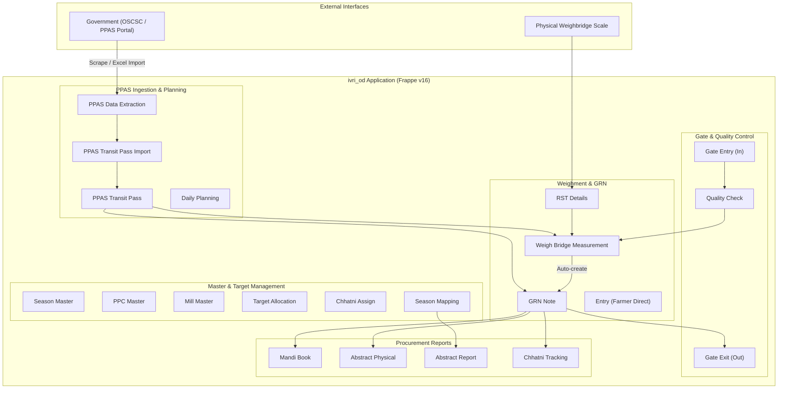
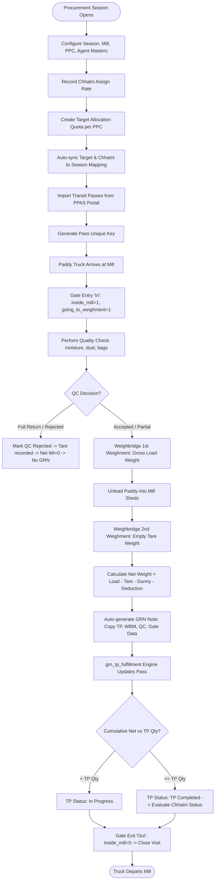
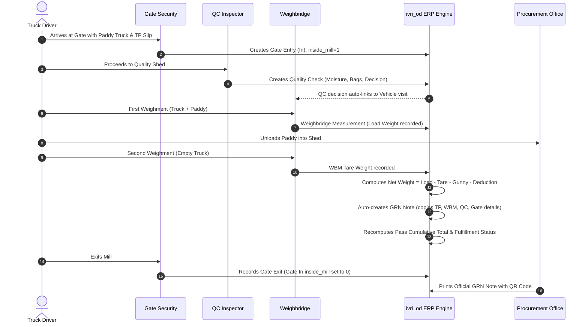
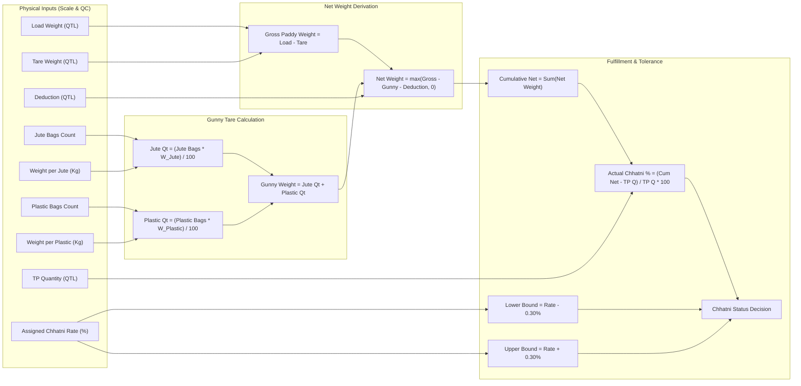
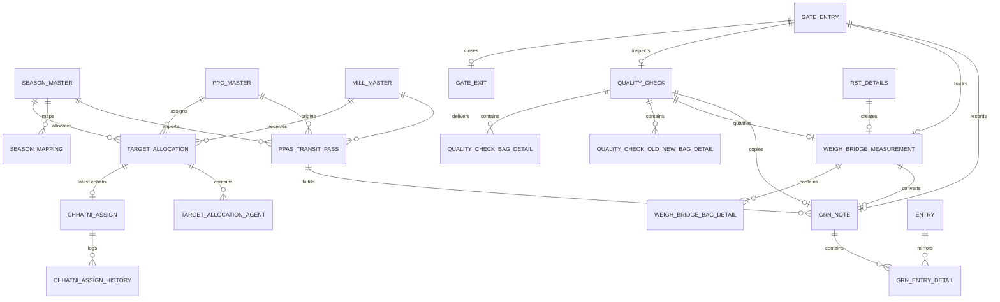
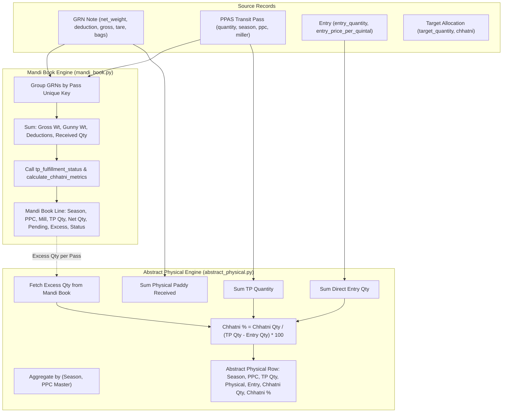
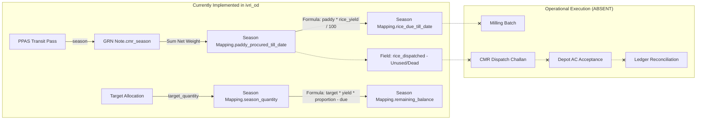
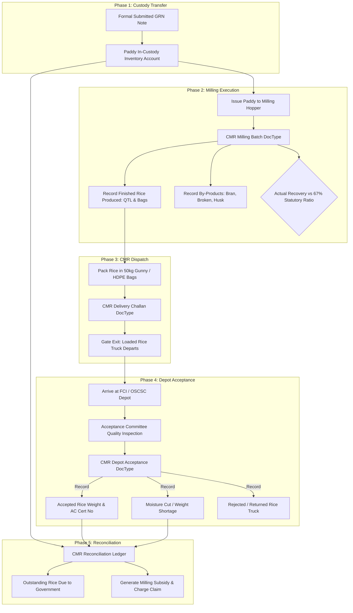

# 07: Technical Workflow Diagrams & Visual Lineage

This document contains renderable Mermaid diagrams representing the real-world operational and technical architecture of `ivri_od`. Every diagram is grounded in inspected code files, schemas, and tested execution paths.

---

## Diagram Index

1. [Diagram A: System Context & High-Level Module Architecture](#diagram-a-system-context--high-level-module-architecture)
2. [Diagram B: End-to-End Procurement Lifecycle](#diagram-b-end-to-end-procurement-lifecycle)
3. [Diagram C: Operational Transit Pass to GRN Physical Flow](#diagram-c-operational-transit-pass-to-grn-physical-flow)
4. [Diagram D: Multi-GRN Fulfillment & Over-Receipt Decision Flow](#diagram-d-multi-grn-fulfillment--over-receipt-decision-flow)
5. [Diagram E: Mathematical Weight & Chhatni Lineage](#diagram-e-mathematical-weight--chhatni-lineage)
6. [Diagram F: Core DocType Entity-Relationship (ER) Diagram](#diagram-f-core-doctype-entity-relationship-er-diagram)
7. [Diagram G: Mandi Book & Abstract Physical Report Data Lineage](#diagram-g-mandi-book--abstract-physical-report-data-lineage)
8. [Diagram H: Existing CMR Implementation Footprint](#diagram-h-existing-cmr-implementation-footprint)
9. [Diagram I: Proposed CMR Execution Lifecycle (PROPOSED)](#diagram-i-proposed-cmr-execution-lifecycle-proposed)

---

## Diagram A: System Context & High-Level Module Architecture



- **Explanation**: Illustrates the system boundaries, data sources, internal module separation, and operational data flow from external portals down to statutory reports.
- **Source References**: `hooks.py`, `procurement_workspace.py`, `workspace/procurement/procurement.json`.

---

## Diagram B: End-to-End Procurement Lifecycle



- **Explanation**: Step-by-step lifecycle from pre-season quota setup to truck arrival, quality gate, dual weighments, automatic GRN creation, and departure.
- **Source References**: `test_e2e_procurement.py:1-265`, `weigh_bridge_measurement.py:252-265`, `grn_note.py:85-107`.

---

## Diagram C: Operational Transit Pass to GRN Physical Flow



- **Explanation**: Interaction sequence between physical human actors (driver, security, inspector, scale operator) and the automated document generation hooks.
- **Source References**: `mill_gate.py:56-125`, `weigh_bridge_measurement.py:1105-1145`, `grn_note.py:1354-1367`.

---

## Diagram D: Multi-GRN Fulfillment & Over-Receipt Decision Flow

```mermaid
flowchart TD
    Trigger([GRN Note Saved / Updated / Trashed]) --> FetchGRNs[Query all GRNs for Pass Unique Key where docstatus < 2]
    FetchGRNs --> SortChron[Sort Chronologically: receipt_datetime asc, creation asc]
    SortChron --> Accumulate[Cumulative Received = Sum of net_weight<br>Cumulative Deduction = Sum of deduction]

    Accumulate --> CheckFulfill{Cumulative Received vs TP Qty}
    CheckFulfill -->|Cumulative == 0| SetPending[TP Fulfillment Status: 'Pending']
    CheckFulfill -->|0 < Cumulative < TP Qty| SetInProgress[TP Fulfillment Status: 'In Progress']
    CheckFulfill -->|Cumulative >= TP Qty| SetCompleted[TP Fulfillment Status: 'TP Completed']

    SetInProgress --> ChhatniBlocked[Chhatni Status: 'Chhatni Not Received'<br>Remark: TP not fully received yet]
    SetPending --> ChhatniBlocked

    SetCompleted --> ChhatniCalc[Calculate Actual Chhatni % = (Cumulative - TP Qty) / TP Qty * 100]
    ChhatniCalc --> ChhatniBounds[Bounds: Assigned % ± 0.30% Tolerance]

    ChhatniBounds --> ChhatniCheck{Actual % vs Tolerance Bounds}
    ChhatniCheck -->|Actual > Upper Bound| ExtraChhatni[Status: 'Extra Chhatni Received']
    ChhatniCheck -->|Lower Bound <= Actual <= Upper Bound| MatchedChhatni[Status: 'Chhatni Received']
    ChhatniCheck -->|Actual < Lower Bound| ShortfallChhatni[Status: 'Chhatni Not Received']

    ExtraChhatni --> WriteBack[Write Statuses directly to all peer GRNs via db.set_value]
    MatchedChhatni --> WriteBack
    ShortfallChhatni --> WriteBack
    ChhatniBlocked --> WriteBack
    WriteBack --> End([Fulfillment Complete])
```

- **Explanation**: Multi-trip accumulation and the mathematical branching governing Transit Pass completion and Chhatni status determination.
- **Source References**: `grn_tp_fulfillment.py:50-210`, `grn_tp_fulfillment.py:279-354`.

---

## Diagram E: Mathematical Weight & Chhatni Lineage



- **Explanation**: Detailed mathematical dependency graph tracing raw measurement inputs to final net weight, gunny bag deduction, cumulative rollups, and tolerance boundaries.
- **Source References**: `weigh_bridge_measurement.py:158-165, 724-738`, `grn_tp_fulfillment.py:140-210`.

---

## Diagram F: Core DocType Entity-Relationship (ER) Diagram



- **Explanation**: Structural relationship entity-relationship model linking master entities, gate records, inspection sheets, weighment slips, and receipt vouchers.
- **Source References**: Checked-in `.json` schemas across `ivri_od/procurement/doctype/`.

---

## Diagram G: Mandi Book & Abstract Physical Report Data Lineage



- **Explanation**: Data aggregation lineage illustrating how `Mandi Book` aggregates per transit pass and feeds downstream into `Abstract Physical` per PPC.
- **Source References**: `mandi_book.py:152-295`, `abstract_physical.py:80-277`.

---

## Diagram H: Existing CMR Implementation Footprint



- **Explanation**: Highlights the minimal static estimation logic currently present in `Season Mapping` versus the operational milling and dispatch capabilities that are absent.
- **Source References**: `season_mapping.py:67-80`, `grn_note.py:383`.

---

## Diagram I: Proposed CMR Execution Lifecycle (PROPOSED)

> [!NOTE]
> This diagram represents a **PROPOSED architecture** designed to complete the CMR module. It contains no claims of existing implementation.



- **Explanation**: Future-proof end-to-end technical blueprint for Custom Milled Rice operations, closing the gap between paddy intake, mill hoppers, finished rice delivery, and government subsidy settlement.
