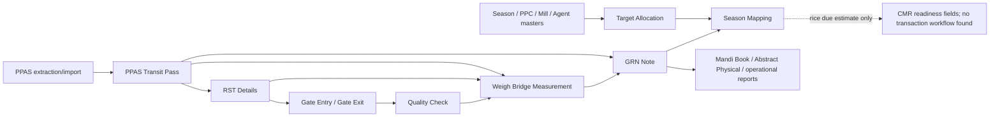
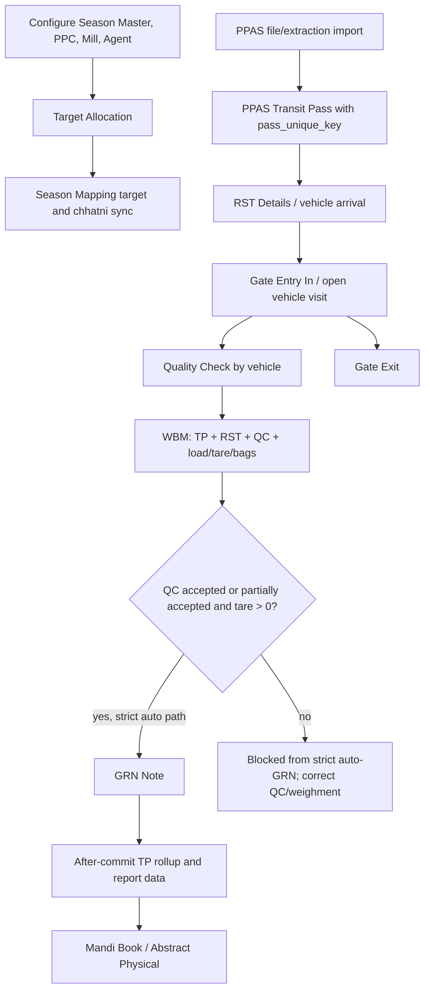
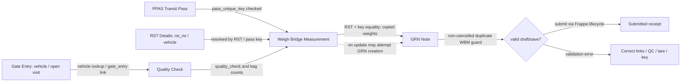
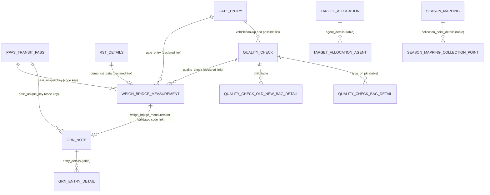
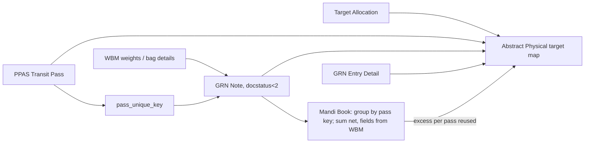
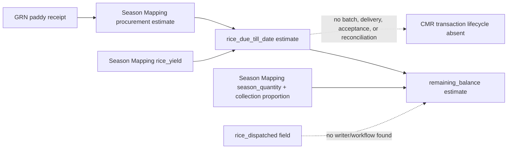
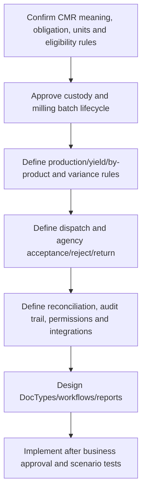

# Workflow diagrams

All diagrams are source-grounded summaries, not runtime proof. References are repository-relative.

## Index and overall context



Evidence: `hooks.py`; Procurement DocType JSON/controllers; `season_mapping.py`; reports. Unknown: actual role permissions and runtime wiring.

## Procurement workflow



Evidence: `grn_note.py:85-105, 430-489`; `weigh_bridge_measurement.py:290-323`; `gate_entry.py`, `gate_exit.py`, QC controller; reports. Gate/QC/WBM exact ordering admits exceptions; arrows express common route.

## TP -> Gate -> WBM/RST -> QC -> GRN



Evidence: WBM validation and GRN `_apply_weigh_bridge`; duplicate checks. Runtime auto-create availability unverified.

## Multiple GRN fulfillment decisions

```mermaid
flowchart TD
  A[TP key] --> B[Collect GRNs for exact key]
  B --> C{Aggregation selector}
  C -->|canonical helper docstatus=1| D[Submitted-only sum net_weight]
  C -->|stored rollup/report docstatus<2| E[Draft + submitted sum net_weight]
  D --> F{sum vs TP}
  E --> F
  F -->|<=0| P[Pending]
  F -->|0 < sum < TP| IP[In Progress; pending TP-sum]
  F -->|sum >= TP| Done[TP Completed; excess=max(sum-TP,0)]
  Done --> Ch[Chhatni status against assigned rate ±0.30 pp]
  F -. no hard excess rejection found .-> Done
```

Evidence: `grn_tp_fulfillment.py:50-137, 267-` and `mandi_book.py` aggregation. The selector divergence is deliberate to flag, not resolve.

## Weight / deduction lineage

```mermaid
flowchart LR
  QC[QC bag counts] --> bags[WBM bag detail × kg per bag / 100]
  load[Load weight] --> gross[Gross = load - tare if both truthy; else load]
  tare[Tare weight] --> gross
  gross --> net[Net=max(gross - gunny - deduction,0), 3 decimals]
  bags --> gunny[Gunny weight; manual positive override may win]
  gunny --> net
  ded[WBM deduction] --> net
  net --> grn[Copied GRN.net_weight]
  grn --> cumul[Per TP cumulative receipt]
  cumul --> ch[Excess %, chhatni, pending/excess]
  ded --> bal[TP chhatni balance = max(cumulative - TP - deductions,0)]
```

Evidence: `weigh_bridge_measurement.py:722-737`; `grn_note.py:430-489`; `grn_tp_fulfillment.py:24-47, 140-210`.

## Core relationships (ER)



ER field cardinalities are conceptual; code checks do not establish DB uniqueness. Exact field declarations in inventory.

## Report lineage



Evidence: `mandi_book.py:148+`, `abstract_physical.py:80+`; Mandi Book and Abstract Physical both include drafts in seen GRNs.

## Existing CMR flow



## Proposed CMR completion (PROPOSED)



No node after “confirm” is a claim about existing implementation. Decisions required in `06_CMR_READINESS_AND_ROADMAP.md`.
