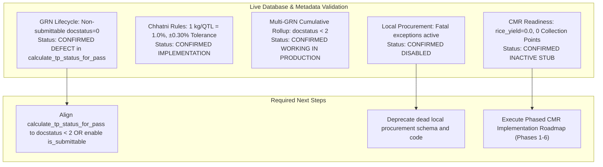

# 00: Live System Validation & Audit Synthesis

## 1. Executive Summary

This report delivers a focused, evidence-based validation of the system workflow audit for the Frappe v16 application **`ivri_od`** on site **`shyamji`**, testing earlier static findings directly against live metadata, database records, and effective configurations.

### Key Discoveries from Live Inspection:
1. **GRN Lifecycle Defect Confirmed**: In the live database, `GRN Note` is confirmed to be **non-submittable** (`is_submittable = 0` in both DocType JSON and `tabDocType`). All **28 existing GRN records** in `tabGRN Note` have `docstatus = 0` (Draft). The standalone helper `calculate_tp_status_for_pass()` strictly filters `docstatus == 1` and thus permanently returns `"Pending"` for all live transit passes. In contrast, the internal engine `_refresh_tp_fulfillment_for_pass()` queries `docstatus < 2` and has successfully computed and stored `"In Progress"` (19) and `"TP Completed"` (8) on those same 28 records.
2. **CMR Inactive State in Database**: All **49 records** in `tabSeason Mapping` have `rice_yield = 0.0`. The child table `tabSeason Mapping Collection Point` has **0 records** in the entire database. Consequently, the rice due and remaining balance calculations have never produced non-zero values on site `shyamji`. The field `rice_dispatched` does not exist on the parent `Season Mapping` table at all; it exists only in the empty child table.
3. **No Custom Fields or Workflows**: A full audit of `tabCustom Field` and `tabWorkflow` revealed **0 custom fields** and **0 workflows** across all 30 procurement DocTypes.
4. **Active Property Setters**: `tabProperty Setter` hides `tp_fulfillment_section` on `GRN Note`, hides `qc_bag_details` on `GRN Note`, hides `qc_decision_section` on `Quality Check`, and sets `no_of_bags` and `pass_unique_key` to read-only on `Weigh Bridge Measurement`.
5. **Multi-GRN Operational Evidence**: Live database evidence confirms that Transit Passes are fulfilled across multiple GRNs. For example, pass `M051007-MALMANDA(S1051105)-K25-TP-300-6P` links to **6 distinct GRNs** (`GRN-2026-00022` through `GRN-2026-00027`), with progressive cumulative quantities tracked from 48.0 QTL up to 288.0 QTL.
6. **Local Procurement Dead Code**: Live code inspection confirms that controllers for WBM, GRN, RST, and PO throw fatal exceptions blocking any new local procurement.

---

## 2. Environment Baseline

| Attribute | Verified Value | Verification Method |
|---|---|---|
| **Bench Path** | `/home/hp/frappe-bench-v16` | Filesystem inspection |
| **Site Name** | `shyamji` | `frappe.local.site` live session |
| **App Name & Version** | `ivri_od` (0.0.1) | `bench --site shyamji list-apps` |
| **Frappe Framework** | 16.30.0 (`version-16`) | `bench --site shyamji list-apps` |
| **ERPNext** | 16.31.1 (`version-16`) | `bench --site shyamji list-apps` |
| **Git Branch / Commit** | `main` / `eb897fe` | `git status`, `git log -n 1` |
| **Git Worktree Status** | Clean (untracked `docs/` preserved) | `git status` |
| **Database Connectivity** | MariaDB MySQL Client via socket | `frappe.connect()` live execution |

---

## 3. Live Record Census on Site `shyamji`

A complete read-only query of the operational procurement tables revealed the following record counts:

```
DocType Table Name                    Record Count   Operational Significance
---------------------------------------------------------------------------------------------------
tabPPAS Transit Pass                  656            Government passes imported from PPAS portal
tabGRN Note                           28             Goods Receipt Notes (all docstatus = 0)
tabWeigh Bridge Measurement           29             Weighment records (gross, tare, net weights)
tabRST Details                        14             Computer RST weighment slips
tabQuality Check                      14             Quality inspection records
tabGate Entry                         14             Gate In/Out vehicle visit movements
tabGate Exit                          13             Gate Out vehicle departure logs
tabTarget Allocation                  49             PPC-wise target quotas for Kharif 2025
tabSeason Mapping                     49             PPC season rollups (all rice_yield = 0.0)
tabChhatni Assign                     48             Agreed Chhatni allowance rates per PPC
tabPPC Master                         48             Authoritative Primary Procurement Centers
tabDistrict Master                    30             Districts of Odisha
tabMill Master                        5              Registered rice mills
tabAgent Master                       3              Procurement agents
tabSeason Master                      2              Kharif 2025, Rabi 2025
tabEntry                              2              Direct farmer purchase records
tabDaily Planning                     0              Truck planning documents
tabSociety Master                     0              Cooperative societies
tabSeason Mapping Collection Point    0              Child table for CMR rice due (completely empty)
```

---

## 4. Synthesis of Audit Findings & Status



| Finding ID | Domain | Previous Audit Concern | Live Validation Result | Evidence Classification | Severity |
|---|---|---|---|---|---|
| **VAL-01** | Document Lifecycle | `calculate_tp_status_for_pass()` checks `docstatus == 1`, but GRN Note metadata is not submittable. | **Confirmed Defect**: `is_submittable = 0`, all 28 live GRNs have `docstatus = 0`. Helper permanently returns `"Pending"`. | `VERIFIED AT RUNTIME & IN DB` | **Critical** |
| **VAL-02** | Rollup Engine | Multiple GRNs per TP and cumulative quantity rollups. | **Confirmed Operational**: `_refresh_tp_fulfillment_for_pass()` uses `docstatus < 2` and correctly maintains cumulative totals. | `VERIFIED AT RUNTIME & IN DB` | **Low (Working)** |
| **VAL-03** | CMR Module | `rice_dispatched` and CMR calculations exist in app. | **Clarified Implementation**: Field is in child table `tabSeason Mapping Collection Point` (0 rows in DB). Parent `rice_yield` is 0.0 across all 49 rows. CMR is an inactive stub. | `VERIFIED AT RUNTIME & IN DB` | **High (Readiness Gap)** |
| **VAL-04** | Chhatni Tolerance | $\pm 0.30$ percentage points tolerance rule. | **Confirmed Code Implementation**: Hard-coded constant `CHHATNI_TOLERANCE_PCT = 0.30` in `grn_tp_fulfillment.py:17`. | `VERIFIED IN CODE` | **Medium (Business Rule)** |
| **VAL-05** | Local Procurement | Local procurement code paths exist but may be inactive. | **Confirmed Disabled**: Hard-blocked by validation errors in controllers (`frappe.throw`). | `VERIFIED IN CODE` | **Low (Tech Debt)** |
