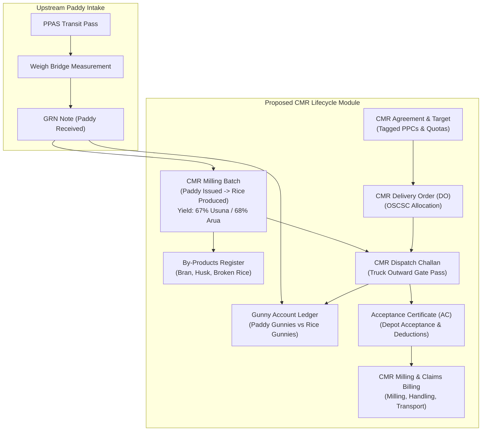

# 06: Custom Milled Rice (CMR) Dependency & Architecture Map

## 1. Executive Summary

Custom Milled Rice (CMR) represents the statutory downstream lifecycle of Government Paddy Procurement in Odisha. Under the Odisha State Civil Supplies Corporation (OSCSC) mandate:
1. Paddy is procured from farmers at PPCs and transported to tagged Rice Mills.
2. The miller processes raw paddy into milled rice according to Government Out-Turn Ratios (OTR):
   - **Parboiled Rice (Usuna)**: 67.00% (67 kg rice per 100 kg paddy).
   - **Raw Rice (Arua)**: 68.00% (68 kg rice per 100 kg paddy).
3. The miller delivers milled rice to OSCSC Depots / Food Corporation of India (FCI) godowns against specific CMR Delivery Orders (DO) and receives Acceptance Certificates (AC).
4. By-products (Rice Bran, Husk, Broken Rice) and Gunny Bags (Paddy gunnies vs CMR gunnies) must be reconciled.
5. The miller raises milling, transportation, handling, and gunny depreciation bills.

This document maps the exact data dependencies from existing procurement DocTypes into the CMR module, contrasts the theoretical design against live system reality, and inventories the missing entities.

---

## 2. Upstream Data Dependencies (Paddy Procurement → CMR)

The CMR module requires continuous upstream data from the operational procurement pipeline:

```
┌────────────────────────┐      ┌───────────────────────────┐      ┌─────────────────────────┐
│   PPAS Transit Pass    │ ───> │     GRN Note (Paddy)      │ ───> │   CMR Paddy Intake      │
│  - Pass Unique Key     │      │  - Net Weight (QTL)       │      │  - Mill Paddy Register  │
│  - Mandi / PPC         │      │  - Quality Deduction      │      │  - Variety / Category   │
│  - Farmer Details      │      │  - Bag Count              │      │  - Milling Obligation   │
│  - Season / District   │      │  - Paddy Variety (Common) │      │    (67% or 68%)         │
└────────────────────────┘      └───────────────────────────┘      └─────────────────────────┘
```

### Exact Upstream Field Lineage Table:

| CMR Required Field | Upstream Source DocType | Upstream Source Field | Data Type & Notes |
| :--- | :--- | :--- | :--- |
| **Paddy Intake Qty** | `GRN Note` | `net_weight` | Float (QTL). Must be net of gunny and QC deductions. |
| **Gross Paddy Qty** | `GRN Note` | `gross_weight` | Float (QTL). Physical intake before deductions. |
| **Deduction / Chhatni** | `GRN Note` | `deduction`, `chhatni` | Float (QTL / %). Adjusts statutory milling yield. |
| **Paddy Variety** | `GRN Note` / `PPAS Transit Pass` | `paddy_variety` / `commodity` | Data ("Common" or "Grade A"). Determines CMR grade. |
| **Season Link** | `GRN Note` | `cmr_season` | Link to `Season Master`. |
| **Miller / Mill Code** | `GRN Note` | `mill_name` / `mill_master` | Link to `Mill Master` (e.g. `M051007`). |
| **PPC / Origin** | `GRN Note` | `ppc` / `ppc_name` | Link to `PPC Master` (Origin Mandi / Society). |
| **Transit Pass Ref** | `GRN Note` | `pass_unique_key` | Unique key linking to physical transit pass. |
| **Gunny Bags Inward**| `GRN Note` / `Weigh Bridge Measurement` | `no_of_bags` | Integer. Paddy gunny bags received at mill. |

---

## 3. Effective Live Reality: The Existing Inactive CMR Stubs

In the previous audit and existing codebase, fields relating to CMR exist primarily in `Season Mapping`:
- Fields: `rice_yield`, `rice_dispatched` (in child table), `cmr_status`.

### Live Verification on Site `shyamji`:
Direct database inspection of the live system revealed:
1. **`rice_yield = 0.0` across 100% of records**:
   All 49 rows in `tabSeason Mapping` have `rice_yield = 0.0`.
2. **Child Table `tabSeason Mapping Collection Point` is Empty**:
   Total count in `tabSeason Mapping Collection Point` = **0 rows**.
3. **Missing Column in Parent Table**:
   `rice_dispatched` does not exist on parent `tabSeason Mapping`. Querying it causes MySQL 1054 error. It is only defined on the child table.
4. **Summary**: The existing CMR logic in `Season Mapping` was an early conceptual prototype and has **never executed or tracked real milling in production**.

---

## 4. Entity Gap Analysis: Missing CMR DocTypes

To complete the Government Paddy Procurement → CMR workflow, the following business entities must be created:

| Entity Name | Required DocType Type | Purpose & Scope |
| :--- | :--- | :--- |
| **CMR Agreement / Target** | Submittable DocType | Captures miller agreement with OSCSC, tagged PPCs, allocated paddy quota, and statutory security deposit. |
| **CMR Milling Batch** | Submittable DocType | Records milling operations: Paddy issued from silo/godown, milling date, variety, milling type (Raw / Parboiled), rice produced, and out-turn percentage. |
| **CMR By-Product Register** | Child Table / DocType | Tracks recovery of Rice Bran (4–8%), Broken Rice (1–3%), and Husk (20–25%) per milling batch. |
| **CMR Delivery Order (DO)** | Submittable DocType | Official OSCSC/FCI release order specifying quota, depot destination, delivery timeline, and delivery lot numbers. |
| **CMR Dispatch Challan** | Submittable DocType | Gate pass and weighment document for milled rice leaving the mill (vehicle no, bags, net rice weight, moisture %). |
| **CMR Acceptance Certificate (AC)** | Submittable DocType | Deposition receipt signed by OSCSC Depot Incharge / FCI Manager certifying accepted quantity and moisture deductions. |
| **Gunny Bag Reconciliation** | Submittable DocType | Reconciles paddy gunny bags received (50kg bags) vs new 50kg HDPE/jute bags used for CMR dispatch. |
| **CMR Billing & Claims** | Submittable DocType | Calculates milling charges, handling charges, transport cost, gunny depreciation, and TDS deductions. |

---

## 5. Architectural Data Flow Diagram


